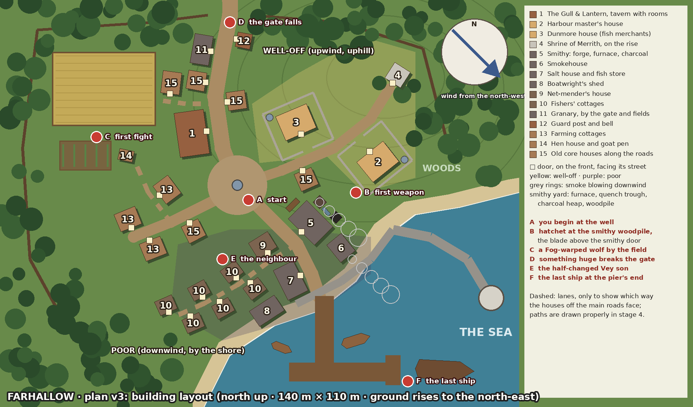

# Farhallow

The village where every player begins, and which the Fog takes on the first evening (lore.md, "The start: the fall of
Farhallow"). Planned with the city-planning skill: lore, logistics, building layout, paths, doodads.

## 0. Who it is for

Freefolk of every people, building mostly the Wayfolk way (`docs/peoples/wayfolk.md`), poorer and plainer: cottages
and village street houses, thatch and shingles, few tiles, almost no pipes. Other peoples' family houses follow when
their culture sheets are written. An old waystone by the well, older than the village, its lamp kept lit by the shrine
keeper; no waylodge, since Farhallow lies outside Hollin's circle (chosen).

## 1. Lore

**Who lives here.** About 50 freefolk of every people, in a dozen households, small enough that everyone knows everyone: families who could not afford to move inward toward Aldrath, and a
few who chose the edge of the world on purpose. Most fish; the rest farm the clearing, smith, keep the tavern or serve
the harbour.

**How they live.** The sea feeds the village. Fishers bring in herring and cod at dawn; it is gutted, salted and smoked
on the shore, and twice a month a trader's ship carries the barrels to Hollin's Cross. Iron, cloth, lamp oil and tools come back; the salt is their own, boiled from seawater on the shore. The fields give barley, beans and hay; hens and a few goats live by the cottages. The smith mends boat fittings,
hooks, tools and the odd blade.

**Rich and poor.** Uneven, as fishing villages are:

- **Well-off:** the **harbour master** (who owns the pier and takes a cut of every catch landed) and the **Dunmores**,
  the fish-merchant family who buy the catch, salt it and sell it to the traders' ships. They live up on the rise, out of
  the smoke and the smell, with glazed windows, walled gardens, a well of their own and a view of the bay.
- **Middling:** the tavern keeper, the smith, the farming families and the old core of houses round the well.
- **Poor:** the fishers and net-menders, in small patched cottages crowded along the shore lanes by the smokehouse,
  sharing the village well, owing the Dunmores for their boats.

**How far from Aldrath.** Far: on the main continent's far coast, outside any god's circle. Colours are already a little
faded, and the woods have a stillness the old folk don't talk about.

**History.** Farhallow began as a summer fishing camp in the bay, sheltered by a reef that later became the breakwater.
The first Dunmore built the salt house and kept the camp through a winter; houses followed round the spring that is now
the well. The palisade went up within living memory, after wolves got bold. The lighthouse is the newest thing in the
village, paid for by the harbour master and resented for its tolls.

**Named people** (seeds for quests and the prologue):

- **Bram Coyle**, harbour master: proud of his lighthouse, hated for his tolls; his ship is the last out.
- **Edda Dunmore**, head of the fish-merchant family: shrewd, generous only when watched.
- **Marta Hesk**, keeper of the Gull & Lantern: knows everyone's debts and everyone's secrets.
- **Old Tobin**, the smith: the blade above his door is his father's, never sold.
- **Wenna Rook**, the shrine keeper of Merrith: the first to notice the wind turning.
- **The Vey family**, fishers by the smokehouse: their eldest son is the half-changed neighbour.

**What it is for in the game.** The prologue's tutorial and first evening: moving, talking, picking up and equipping
the first weapon, the first fight, the hard moment, the gate falling, the escape to the last ship.

**Climate and wind.** Cool and damp, with sea mist most mornings. The **prevailing wind is from the north-west**, off the
hills and fields and down over the village to the sea: it carries forge and smokehouse smoke out over the bay. On the
evening the Fog comes, the wind dies and swings round to blow in from the sea for the first time anyone remembers.

**Vegetation** *(the region's, to refine when the regions are written)*: a cool, damp temperate coast. Mixed woods of
Scots pine and sessile oak with birch on the edges, holly and hazel in the understorey, ferns and bramble beneath; gorse
and heather on the open rise; marram grass and sea pinks on the dunes, wrack and kelp on the shore; barley, oats and
beans in the fields. Far from Aldrath, so the woods are a little greyer and stiller than they should be. *(The game
uses generic pines and broadleaves for now; the region's own trees, gorse and dune grass are still to make.)*

## 2. Logistics

The ground rises from the harbour (south-east) to a rise in the north-east. The road from the interior enters through
the north gate. Downwind means south-east, toward the harbour and the bay.

### Supply: can Farhallow live on its own?

It must: it lies at the far edge of the world, two days by sea from Hollin's Cross, and the coast road is long and
unsafe. So it grows or catches its own food, burns its own wood, draws its own water and makes its own salt. The trader's
ship brings only what the village cannot make, and Farhallow would survive a season without it.

About 50 people × 2,000 kcal a day is about 37 million kcal a year:

| Food | Share | How much | Where it comes from |
| --- | --- | --- | --- |
| Fish (herring, cod, mackerel; fresh, smoked, salted) | ~40% | ~12 t a year eaten, plus the surplus salted for trade | 3-4 boats from the pier; the smokehouse and salt house keep it |
| Grain (barley, oats; bread, porridge, ale) | ~40% | ~4.5 t a year | **~6-7 ha sown each year, ~12-15 ha of open fields in two halves (one rests fallow)**, outside the palisade along the north road and west of it, worked in strips by every household |
| Beans, peas, cabbage, onions, roots | ~8% | | the house plots and the small infield inside the palisade |
| Hens, goats (milk, cheese), pigs | ~7% | | yards and the hen house; goats and pigs on the common at the wood's edge |
| Foraging | ~5% | | shellfish and seaweed from the shore, berries, mushrooms, nuts and small game from the woods |

- **Water:** the well (the old spring the village grew round), rain barrels.
- **Fuel:** firewood and the smith's charcoal from the woods round the clearing; driftwood.
- **Salt:** boiled from seawater in pans by a small salt-boiling hut on the shore, downwind; stored in the salt house.
- **Winter stores:** the granary holds next year's seed and about three months of grain; smoked and salted fish in the
  smokehouse and salt house; roots in house cellars. A bad harvest means a lean spring, not starvation.
- **Imports** (the trader's ship, twice a month): iron bars, cloth, lamp oil, tools, and wine and spices for the
  well-off. **Exports:** salted and smoked fish, some salt.
- **If the ships stop:** Farhallow eats; it runs short of iron, oil and cloth. (On the night of the prologue the trader's
  ship is the last ship out.)

**Changes this made:** the fields inside the palisade are only the infield (beans and barley close to home); the real
fields (~12-15 ha) lie outside, along the north road, beyond the edge of the plan. The salt comes from salt pans on the
shore instead of the trader's ship.

| Building or facility | Where | Why there | What sits with it |
| --- | --- | --- | --- |
| **The Gull & Lantern** (tavern with rooms) | West side of the well square, on the gate road | Locals gather at the square; travellers off the road walk straight in. Not at the edge | Benches, a sign, a lamp, barrels by the side door, a stable post |
| **Village well and square** | Centre, where the gate road meets the harbour road and the west lane | The old spring the village grew round; every lane meets here | Market stalls on trader days, a notice post, a bench, a lamp |
| **Smithy** (forge, furnace, charcoal store) | South-east of the square on the harbour road, downwind | Smoke and noise blow out to sea; close to the boats it serves; on a road for customers and iron deliveries | Anvil, quench trough, charcoal heap, woodpile, grindstone, scrap. The blade above the door (beat B) |
| **Smokehouse** | On the shore by the sea wall, downwind and at the edge | Smoke and fish smell blow out over the bay; next to the catch | Drying racks, wood stack, barrels |
| **Salt house and fish store** (the Dunmores') | At the root of the pier | The catch comes straight off the boats; barrels go straight onto the traders' ship | Barrels, crates, salt sacks, a hand cart |
| **Boatwright's shed** | On the beach west of the pier | Boats are hauled up the beach to be built and mended | A hull on trestles, planks, tar pot |
| **Net-mender's house** | Shore lane near the pier | Works with the fishers every day | Nets on frames, floats, baskets |
| **Fishers' cottages** (poor) | Crowded along the shore lanes by the smokehouse, downwind and downhill | Close to the boats; cheapest ground, in the smoke and smell | Shared well use, a few pots, nets, hens |
| **Harbour master's house** (rich) | On the rise, north-east, upwind of all the smoke | Looks over the bay and his lighthouse; out of the smell | Walled garden, own well, bench, lamp, planters, a paved path |
| **Dunmore house** (rich) | On the rise, between the square and the shrine | Near the shrine and above the square; out of the smell | Walled garden, glazed windows, bench, lamp, planters |
| **Shrine of Merrith** | The top of the rise | High ground, seen from everywhere and from the sea | Candles, offerings, a stone bench |
| **Lighthouse** | End of the breakwater | Marks the reef for boats | Lamp oil stores at its foot |
| **Granary** | By the north gate, next to the fields | Harvest goes in from the fields; stores at the gate for traders and for defence | Sacks, a cart, a ladder |
| **Guard post** | Inside the north gate | Watches the road and the woods | Bell (rings in beat 2), a brazier, a spear rack |
| **Farming cottages** (middling) | West, between the square and the fields | Next to their fields and vegetable plots, upwind | Hen house, goat pen, hay, tools |
| **Old core houses** (middling) | Round the square | The oldest houses, built round the spring | Pots, a bench, washing lines |
| **Infield and vegetable plots** | North-west, inside the palisade | Flat, sunny, upwind, near the granary; safe inside the palisade | Fence, scarecrow, hay stacks |
| **Open fields** (~12-15 ha) | Outside the palisade, along the north road and to the west | The village's grain; far too big to fit inside the walls | Strips, boundary stones, a field barn (beyond the plan's edge) |
| **Common pasture and woodlot** | The wood's edge round the clearing | Goats and pigs, firewood, charcoal | A charcoal burner's clearing |
| **Salt-boiling hut and pans** | On the shore east of the harbour, downwind | Seawater and driftwood at hand; smoke blows out to sea | Pans, a woodpile, sacks |
| **Palisade and north gate** | Round the landward side | Built against wolves; the sea guards the rest | Gate torches |

**Changes from plan v2:** the tavern moves from the west edge to the square; the smithy moves from the rise (upwind,
next to the shrine) down to the harbour road, downwind, and gains a forge, furnace and quench trough; the harbour master
moves from the shore up to the rise; a Dunmore house, smokehouse, salt house, boatwright's shed and guard post are added;
the fishers' cottages crowd the shore lanes; the fish store moves to the pier.

## 3. Building layout

Drawn by `tools/map/farhallow_plan.py` on the characters branch, which checks every building, plot, yard and the
waystone against each other, the roads and lanes, the square, the palisade, the fields, the sea and the beach.

**Every building on the plan is a real floorplan** from `tools/map/building_types.py`, the same file the floorplan sheet
and (later) the 3D builder read, so what is planned is exactly what gets built and nothing overlaps later. The clash
check runs on every room, yard and plot. Placing the real sizes changed the village:

- The inn is the full 12 × 16 m inn with its coach yard and stable; the field was narrowed by 2 m to fit it.
- The Dunmores have the merchant's house with coach yard (they cart barrels); the harbour master has the smaller
  well-off house without one; both now face the rise road from its uphill side, with walled gardens behind. The rise
  road was straightened a little for their fronts.
- The smithy is the workshop type, with anvil and quench trough in the work bay and charcoal and woodpile in its yard.
- **A remote fishing village, kept small (chosen):** the palisade stays as it is, big enough for the tutorial; three
  fishers' cottages and the net-mender's remain (two were dropped), so it feels like a hometown where everyone knows
  everyone, about 50 people.
- The farms are one farmstead (house, byre and barn round a yard) and one farming cottage.
- Only one old street house remains (by the fields): the street-house type is 6 × 10 m with a plot, and there was no
  room for the others by the square or on the west road. The fishers' cottages are the cottage type; where they have no
  room for a plot they share a yard, as the Wayfolk poor do.
- The village waystone (3 × 3 m) stands in the square facing the gate road.

## 4. Paths

The main roads (gate, harbour, west and rise roads) and three lanes (the shore lane through the fishers' quarter, the
field lane to the field gate, the farm lane to the hen house and vegetable plots), plus a short path from every door to
its street. The plan script checks that every door reaches a path without crossing anything, that every lane starts and
ends on another path, at a door or at a named place (the field gate, the plots), and that every lane is used.

## 5. Doodads

63 props, each with a purpose written beside it. Most come with their building type (`building_types.py`), so every
inn, cottage or workshop brings its own: benches by doors, woodpiles and washing lines in yards, the inn's lantern,
sign, horse trough and ale barrels, the smithy's anvil, quench trough, grindstone, charcoal and woodpile (where the
hatchet waits for beat B), the well-off houses' own wells, fruit trees, flower beds and garden benches, the farm cart,
trough and manure heap, the guard post's alarm bell, the shrine's bench and candles, the salt works' driftwood and
sacks, barrels and crates outside the salt house, the half-built hull in the boatwright's shed. Plot props appear only
where the plot is deep enough for them.

Farhallow's own: the harbour master's notice post by the waystone, a bench by the well, gate torches on the gate posts,
a scarecrow and a haystack in the infield, net racks on the beach by the fishers, a fish-drying rack by the smokehouse,
a gutting table where the catch lands, lobster pots and barrels on the pier, and crates at the pier's end waiting for
the trader's ship (the last ship of the prologue).

The plan script checks each one: it has a purpose; every corner stands on ground its kind allows (flowers and fruit
trees only in gardens, nets on the beach or in yards, lobster pots on the pier or beach, the anvil inside the
workshop...); it is not on a road, lane or door path and keeps a metre clear of every door; it overlaps nothing.
Lamps, signs, candles and torches hang on walls and posts, so only where they hang is checked.

The poor cottages without a plot share the open ground between them; their nets dry on the beach.
